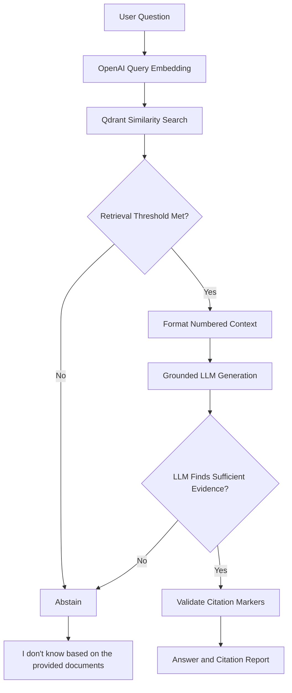

# MP3 — Grounded Q&A: A Cited Document Assistant

**Author:** Sushweta Biswas

**Course:** AI-RAG — Week 12 Graded Mini Project

## Overview

A retrieval-augmented generation (RAG) assistant that answers
questions about five Sherlock Holmes stories using retrieved
document evidence, numbered citations and controlled abstention.

The project extends the MP2 retrieval pipeline with citation
validation, evidence-based refusal and a four-metric evaluation
harness.

## Final results

| Metric | Baseline K=3 | Final K=7 |
|---|---:|---:|
| Retrieval hit rate | 100% | 100% |
| Grounded response rate | 50% | 100% |
| Abstention accuracy | 100% | 100% |
| Hallucination rate | 0% | 0% |
| Questions passed | 6/9 | 9/9 |

Additional verification:

- Original offline selftests: 13/13 passed.
- Controlled citation validation tests: 4/4 passed.
- Final live regression evaluation: 9/9 passed.
- Automatic environment loading: passed.
- Persistent Qdrant collection: 73 chunks, status green.

## Architecture



The implementation uses OpenAI and Qdrant directly, without
LangChain, LlamaIndex or other RAG frameworks.

## Corpus

| Document | Indexed chunks |
|---|---:|
| The Red-Headed League | 13 |
| The Adventure of the Speckled Band | 13 |
| The Adventure of the Blue Carbuncle | 13 |
| The Adventure of the Engineer's Thumb | 16 |
| A Scandal in Bohemia | 18 |
| **Total** | **73** |

## Graded implementation

| Function | Responsibility |
|---|---|
| format_context | Number retrieved passages and preserve source attribution |
| validate_citations | Detect valid, fabricated and missing citation markers |
| should_abstain | Reject empty or insufficiently relevant retrieval results |
| evaluate | Calculate all four evaluation metrics |

## Final configuration

| Parameter | Value |
|---|---|
| Embedding model | text-embedding-3-small |
| Generation model | gpt-4o-mini |
| Embedding dimensions | 1536 |
| Vector database | Qdrant |
| Distance metric | Cosine |
| Collection | mp3_sherlock |
| Chunk size | 500 characters |
| Chunk overlap | 80 characters |
| Retrieval depth | 7 |
| Abstention threshold | 0.30 |

## Getting started

Run all commands from the repository root.

### 1. Create a virtual environment

```bash
python3 -m venv .venv
source .venv/bin/activate
```

### 2. Install dependencies

```bash
python -m pip install -r requirements-tested.txt
python -m pip check
```

The original course dependency ranges are retained in
requirements.txt. The tested file records the direct dependency
versions used during development.

### 3. Configure credentials

```bash
cp .env.example .env
```

Configure OPENAI_API_KEY in .env unless credentials are already
provided by the execution environment.

The application automatically loads .env without overriding
existing environment variables.

Persistent local Qdrant is configured by default and does not
require a separate Qdrant server.

For remote Qdrant, comment out QDRANT_LOCAL_PATH and configure
QDRANT_URL and QDRANT_API_KEY as appropriate.

### 4. Run offline selftests

```bash
python mp3_grounded_qa.py selftest
```

Expected result: all 13 selftests pass.

### 5. Ingest the corpus

```bash
python mp3_grounded_qa.py ingest
```

Expected result: five documents and 73 indexed chunks.

Ingestion recreates the project collection. Run it only when
initializing or intentionally rebuilding the vector index.

### 6. Ask questions

```bash
python mp3_grounded_qa.py ask
```

Enter questions interactively. Submit an empty line to exit.

Example answerable questions:

- Who stole the Blue Carbuncle, and where did he hide it?
- How did Holmes discover where Irene Adler had hidden the
  photograph, and why did he fail to recover it?

Example unanswerable question:

- Who is Professor Moriarty, and how does he meet his end?

Expected refusal:

> I don't know based on the provided documents.

### 7. Run evaluation

```bash
python mp3_grounded_qa.py eval
```

The evaluation combines six predefined questions and three
learner-authored questions.

The learner questions include two answerable questions across
different stories, one multi-hop question, and one plausible
question outside the indexed corpus.

The latest verified results are preserved in mp3_eval.txt.

## Retrieval optimization

A controlled experiment showed that the correct document could
be retrieved without retrieving the passage containing the
specific evidence needed to answer a question.

Increasing retrieval depth improved evidence coverage.

| Retrieval K | Grounded rate | Questions passed |
|---|---:|---:|
| 3 | 50% | 6/9 |
| 5 | 83.3% | 8/9 |
| 7 | 100% | 9/9 |
| 10 | 100% | 9/9 |

K=7 was selected as the smallest tested retrieval depth that
achieved all four ideal evaluation metrics.

## Abstention threshold experiment

With K fixed at 7:

| Threshold | Grounded rate | Abstention accuracy |
|---|---:|---:|
| 0.30 | 100% | 100% |
| 0.50 | 100% | 100% |
| 0.524 | 100% | 100% |
| 0.55 | 83.3% | 100% |
| 0.60 | 33.3% | 100% |

Threshold 0.30 was retained to reduce the risk of false
abstention on unseen questions.

The observed separation between answerable and unanswerable
top similarity scores was only 0.007. A higher threshold
requires independent validation before adoption.

## Citation validation experiment

Four controlled synthetic scenarios were tested:

| Scenario | Result |
|---|---|
| Valid citation | Accepted |
| Fabricated citation | Flagged |
| Mixed valid and fabricated citations | Invalid marker flagged |
| Missing citation | Detected |

These tests verify marker integrity, not factual entailment.
They are not fabricated citations observed in live LLM responses.

## Repository structure

```text
.
├── mp3_grounded_qa.py
├── mp3_eval.txt
├── mp3_reflection.md
├── README.md
├── requirements.txt
├── requirements-tested.txt
├── .env.example
├── .gitignore
├── corpus/
│   └── Five Sherlock Holmes source documents
├── data/
│   ├── predefined_questions.jsonl
│   └── learner_questions.jsonl
└── docs/
    └── experiments/
        ├── citation_validation_results.txt
        ├── k_sweep_results.txt
        ├── mp3_eval_baseline_k3.txt
        ├── mp3_eval_optimized_k7.txt
        ├── mp3_eval_final_regression.txt
        ├── optimization_summary.md
        ├── retrieval_k_experiment.md
        ├── threshold_score_analysis.txt
        └── threshold_sweep_results.txt
```

## Key learning

A perfect document-level retrieval hit rate does not guarantee
that retrieved passages contain sufficient answer evidence.

The baseline retrieved the expected document for every
answerable question, but incorrectly refused three questions.
Increasing retrieval depth eliminated these false abstentions
in the final evaluation.

## Limitations

- The evaluation contains nine questions also used for tuning.
- Independent holdout validation has not been performed.
- Citation validation checks marker integrity. The grounded
  metric additionally checks expected source identity, not
  independent claim-level factual entailment.
- Hallucination rate measures answers to designated unanswerable
  questions, not all possible factual errors.
- Local Qdrant was used because a remote endpoint was unavailable
  in the Vocareum environment.
- The original Qdrant search API produces a deprecation warning.
  The tested dependency version preserves compatibility.
- Live generation results and latency may vary across API calls.

## Supporting documentation

- [Detailed reflection](mp3_reflection.md)
- [Final evaluation](mp3_eval.txt)
- [Optimization summary](docs/experiments/optimization_summary.md)
- [Retrieval experiment](docs/experiments/retrieval_k_experiment.md)
- [Citation validation](docs/experiments/citation_validation_results.txt)
- [Final regression evaluation](docs/experiments/mp3_eval_final_regression.txt)

## Academic context

Completed as part of the Week 12 AI-RAG graded mini project.
The original starter implementation and corpus were supplied
as course materials.
